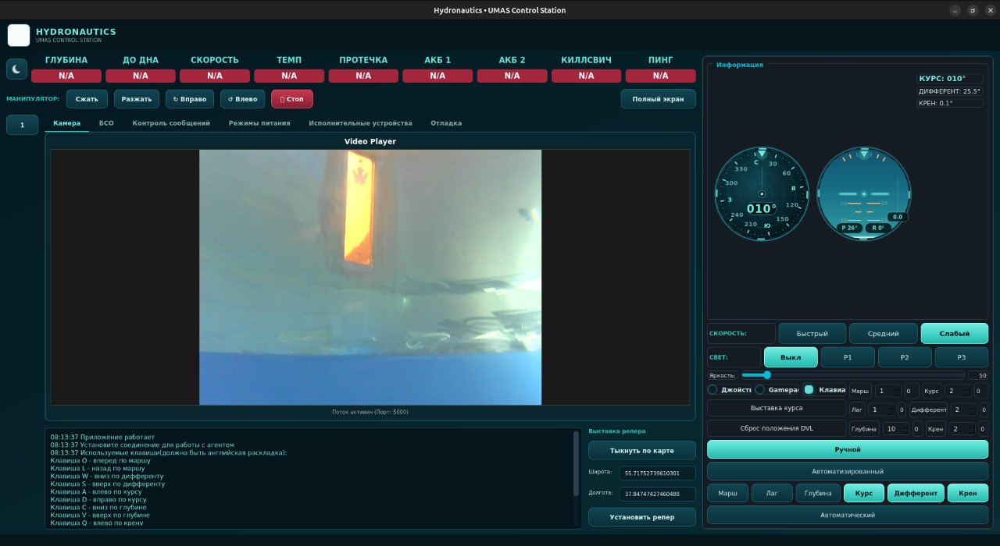
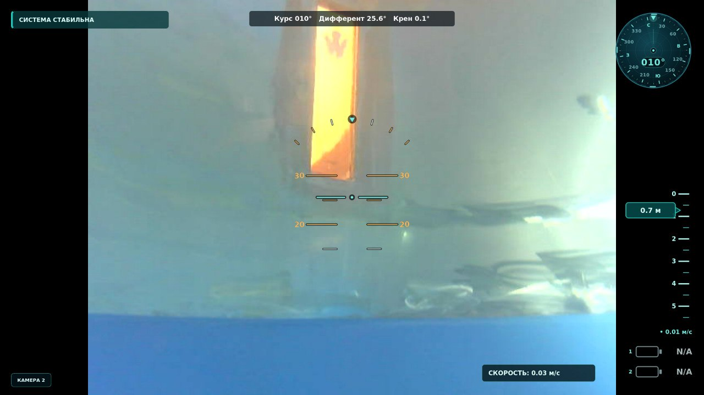

# UMAS GUI

[](https://github.com/hydronautics-team/UMAS_GUI/actions/workflows/ci.yml)
[](https://github.com/hydronautics-team/UMAS_GUI/actions/workflows/docker-image.yml)
[](LICENSE)

Операторский пульт управления подводными аппаратами. UMAS GUI принимает
телеметрию и видеопотоки через ROS 2, отображает состояние аппарата и передаёт
команды оператора в систему управления.



## Возможности

- управление движением аппарата с клавиатуры и геймпада;
- ручной, автоматизированный и автоматический режимы управления;
- настройка контуров стабилизации и прямого воздействия оператора;
- отображение положения, ориентации, глубины и состояния аккумуляторов;
- основной и дополнительный видеопотоки с полноэкранным режимом;
- HUD-приборы, предупреждения и уведомления оператора;
- управление освещением и исполнительными устройствами;
- сброс локальной позиции DVL;
- запись основных ROS 2 топиков в rosbag формата MCAP.

## Технологии

- C++17 и Qt 5;
- ROS 2 Humble;
- GStreamer;
- SFML;
- CMake и Docker.

## Быстрый старт

Для рекомендуемой сборки необходим Docker. Клонируйте репозиторий и выполните
из его корня:

```bash
./scripts/install-cli.sh
umas-gui docker-build
umas-gui build
umas-gui run
```

Для установки ярлыка на рабочий стол:

```bash
./scripts/install-desktop-shortcut.sh
```

По умолчанию приложение использует `ROS_DOMAIN_ID=1`. Другой домен можно указать
при запуске:

```bash
ROS_DOMAIN_ID=2 umas-gui run
```

Подробные требования и варианты локальной сборки приведены в разделе
[«Сборка и запуск»](docs/build-and-run.md).

## Скриншоты

```markdown

```

## Командная строка

| Команда | Назначение |
| --- | --- |
| `umas-gui docker-build` | Собрать или обновить Docker-образ |
| `umas-gui build` | Собрать приложение |
| `umas-gui run` | Запустить операторский пульт |
| `umas-gui record` | Записать основные ROS 2 топики в MCAP |
| `umas-gui shell` | Открыть shell в контейнере разработки |
| `umas-gui format` | Отформатировать исходники C/C++ |
| `umas-gui check` | Проверить форматирование |

## Структура проекта

```text
src/
├── app/             # точка входа и главное окно
├── core/            # состояние аппарата и прикладная логика
├── integrations/    # ROS 2, видео и устройства ввода
└── ui/              # приборы и элементы интерфейса

resources/           # изображения и Qt-ресурсы
docker/              # окружение разработки и сборки
scripts/             # CLI и вспомогательные сценарии
docs/                # документация проекта
archive/             # отключённые legacy-модули
```

Подробнее: [архитектура UMAS GUI](docs/architecture.md).

## Разработка и CI

Изменения вносятся в отдельных ветках через Pull Request в `master`.

Для каждого Pull Request GitHub Actions:

1. собирает Docker-окружение;
2. проверяет форматирование исходников;
3. компилирует приложение через CMake.

После попадания изменений в `master` отдельный workflow публикует Docker-образ.
Правила оформления изменений и Pull Request описаны в
[руководстве участника](docs/contributing.md).

## Документация

- [Сборка и запуск](docs/build-and-run.md)
- [Архитектура и ROS 2](docs/architecture.md)
- [Правила разработки](docs/contributing.md)
- [Стиль кода](docs/coding-style.md)
- [Содержание документации](docs/README.md)

## Лицензия

UMAS GUI распространяется на условиях лицензии [MIT](LICENSE). Сторонние
компоненты сохраняют лицензии своих правообладателей.
