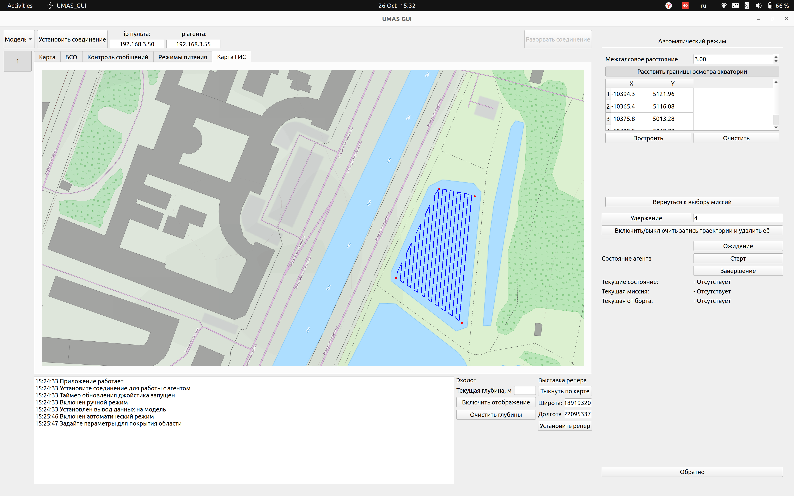

# UMAS GUI

Операторский пульт управления подводными аппаратами. Qt-приложение получает телеметрию и видео через ROS 2, отображает состояние аппарата и отправляет управляющие команды.

## Документация

- [Сборка и запуск](docs/build-and-run.md)
- [Архитектура и структура проекта](docs/architecture.md)
- [Правила разработки](docs/contributing.md)
- [Стиль кода](docs/coding-style.md)
- [Содержание документации](docs/README.md)

Основная разработка ведётся в отдельных ветках с последующим Pull Request в `develop`.
